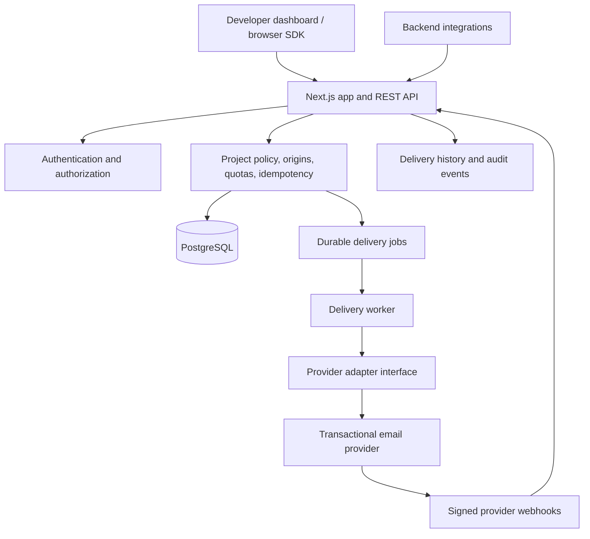

# MailBridge

A self-hostable email delivery platform for websites, mobile apps, and backend services. MailBridge is designed around a versioned API, project-scoped credentials, reusable templates, provider adapters, delivery logs, and enforceable quotas.

> **Status:** Initial foundation. This repository is being built incrementally. Features are only marked complete after implementation and verification. Do not use this foundation to send production email until the security and deployment checklist is satisfied.

## Product goals

- A developer can create isolated projects and reusable email templates.
- A provider adapter sends messages through a verified transactional email provider.
- Public/browser credentials are restricted to explicitly permitted operations; private credentials are server-only.
- API responses distinguish queued, provider-accepted, delivered, bounced, and failed states.
- Usage, rate limits, idempotency, delivery attempts, and audit events are enforced server-side.
- Local development and deployment are reproducible with PostgreSQL and Docker.

## Architecture



The initial deployment target is a container-capable Node.js host plus managed PostgreSQL. The delivery worker must run as a persistent process; static hosting (including GitHub Pages) cannot run the API or worker. Redis is deliberately not mandatory for the first stage: PostgreSQL is the source of truth for durable jobs. A later queue backend can be added behind an interface if throughput requires it.

## Repository structure

```
apps/
  web/                 Next.js dashboard and REST endpoints
  worker/              Persistent delivery worker
packages/
  sdk/                 Browser-safe JavaScript/TypeScript SDK
  config/              Shared lint/TypeScript configuration
prisma/
  schema.prisma        Relational data model and migrations
docs/
  ARCHITECTURE.md
  THREAT_MODEL.md
  OPERATIONS.md
  API.md
Dockerfile
docker-compose.yml
.env.example
.github/workflows/ci.yml
```

## Staged implementation

1. **Foundation:** architecture, threat model, repo scaffold, configuration, CI, and database model.
2. **Identity:** registration/login/logout, verified email, reset flow, sessions, organizations, and membership roles.
3. **Projects and providers:** isolated projects, credential hashing/encryption, sender identities, origin policies, and provider health checks.
4. **Templates and sending:** safe rendering, versioning, provider adapter, send API, idempotency, durable jobs, retries, and webhook event processing.
5. **SDK and dashboard:** onboarding, project/provider/template screens, delivery logs, analytics, and usable mobile layouts.
6. **Hardening:** tenant-isolation, abuse/rate-limit, quota, webhook, and end-to-end tests; dependency/secret scanning.
7. **Release:** deployment, smoke tests, backup/restore validation, runbooks, and release notes.

Each stage should leave the application runnable. The CI workflow is the source of evidence for lint, type-check, test, and build status.

## Security model

- Passwords are hashed with Argon2id; sessions use opaque random tokens stored as hashes and secure, HttpOnly cookies.
- Provider credentials are encrypted with an application key held outside PostgreSQL.
- Private API keys are shown once and stored as hashes. Browser public keys never authorize private or administrative operations.
- Every data access is scoped by authenticated membership or the exact project credential; client-supplied project IDs are not authorization.
- Origin checks reduce browser abuse but are not treated as authentication. Public sending additionally requires configured destination policy and strict quotas.
- Request and delivery logs redact secrets and avoid storing full message bodies by default.
- Webhooks require provider signature verification and idempotent event processing.

See [Architecture](docs/ARCHITECTURE.md), [Threat model](docs/THREAT_MODEL.md), [API notes](docs/API.md), and [Operations](docs/OPERATIONS.md).

## Local development

Requirements: Node.js 20+, npm, Docker with Compose, and a transactional provider account for real sends.

1. Copy `.env.example` to `.env` and fill in local-only values.
2. Start PostgreSQL: `docker compose up -d db`.
3. Install dependencies: `npm install`.
4. Generate Prisma client and apply migrations: `npm run db:generate && npm run db:migrate`.
5. Start the web application: `npm run dev`.
6. Run checks: `npm run lint && npm run typecheck && npm test && npm run build`.

Real email delivery requires a configured provider and a verified sender identity. Automated tests must use mocks and must not send real email.

## Configuration

See `.env.example`. Never commit real credentials. Rotate any secret that is accidentally committed. The production encryption key must be backed up securely and kept separate from the database.

## Known limitations

This is an evolving implementation. Do not assume all planned modules are complete just because they appear in the architecture. Billing, OAuth, attachments, multiple providers, advanced bot protection, and production observability may remain out of scope until explicitly implemented and tested. Provider delivery events depend on provider support; provider acceptance is not proof of inbox delivery.

## Contributing

Open an issue describing the problem or proposed change. Include tests for security-sensitive behavior. Do not include real credentials, recipient data, or private message contents in issues or logs.

## License

License: to be selected by the repository owner before public release.
