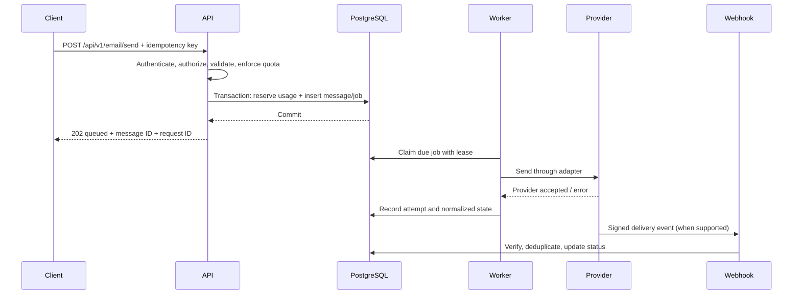

# MailBridge architecture

## Runtime components

- **Web/API:** Next.js serves the dashboard and versioned REST endpoints.
- **Database:** PostgreSQL stores identity, tenants, projects, provider connections, templates, delivery state, quotas, idempotency records, and audit events.
- **Worker:** a separate persistent Node.js process claims durable jobs and calls a provider adapter. A request is acknowledged as queued only after its job transaction commits.
- **Provider adapter:** a stable interface maps provider-specific send results and errors into MailBridge states.
- **Webhook receiver:** verifies provider signatures, stores event IDs uniquely, and applies duplicate/out-of-order-safe state transitions.
- **SDK:** a browser-safe package supports public credentials only; server-side integrations use private credentials.

## Send lifecycle

Provider acceptance is not equivalent to delivery. State changes must be monotonic where possible, while retaining provider events for audit and diagnosing out-of-order reports.

## Tenant isolation

Every tenant-owned query must be constrained by the authenticated user/membership or by the credential's project ID. Never fetch a template, provider, or message by a client-provided identifier and then assume it belongs to the caller. Use transactions for quota reservations and idempotency checks to prevent concurrent duplicate sends.

## Deployment

Run the web service and worker as separate containers with the same release and configuration. Use managed PostgreSQL with encrypted transport and automated backups. The worker needs a persistent runtime; serverless-only deployments require a separate queue/worker design. Keep provider encryption keys and session-related secrets in the host's secret manager, not in the database or repository.
